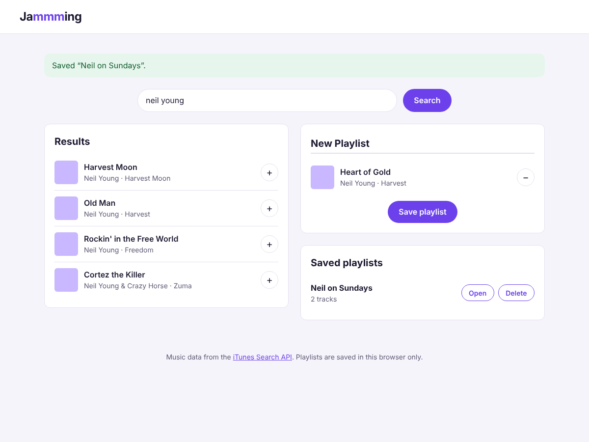

# Jammming

Search for songs, build playlists, and save them. Built from Codecademy's _Jammming_ project
brief with React, TypeScript and Vite, using the free
[iTunes Search API](https://performance-partners.apple.com/search-api). No account or API key
needed.



## Features

- Search songs by title, album or artist, with album artwork and a link to each track on
  Apple Music.
- Add tracks to a playlist and remove them again; tracks already in the playlist are hidden
  from the results.
- Name and save playlists, then reopen, edit or delete them later.
- The playlist you're building survives a page reload.
- Keyboard and screen-reader friendly, responsive down to phone width, light and dark themes.

## Getting started

Requires Node 22+.

```bash
npm install
npm run dev
```

## Scripts

| Command             | What it does                                    |
| ------------------- | ----------------------------------------------- |
| `npm run dev`       | Start the dev server                            |
| `npm test`          | Run the test suite (Vitest + Testing Library)   |
| `npm run lint`      | Lint with Oxlint                                |
| `npm run typecheck` | Type-check with TypeScript                      |
| `npm run format`    | Format with Prettier (`format:check` to verify) |
| `npm run build`     | Production build into `dist/`                   |

CI runs all of the checks above on every push to `main` and on every pull request.

## Deploying to GitHub Pages

In the repository settings, set **Pages → Source** to **GitHub Actions**. Every push to `main`
then deploys to `https://<your-user>.github.io/jammming/`.

## How it works

```
src/
├── App.tsx               state: search results, the playlist being built, saved playlists
├── components/           SearchBar, SearchResults, Playlist, Tracklist, Track, SavedPlaylists
├── lib/itunes.ts         song search
├── lib/playlists.ts      saving playlists in the browser
└── types.ts
```

**Search uses JSONP.** Apple's Search API doesn't reliably send CORS headers, so a plain
`fetch()` from a static site can be blocked by the browser. The API supports JSONP instead:
the response is loaded as a script that hands the results to a callback. It needs no proxy
server and no account. Apple limits searches to roughly 20 a minute per visitor.

**Playlists are saved in `localStorage`**, so they stay in the browser that made them. There
is no account or sync between devices.

### Differences from the Codecademy brief

The brief saves playlists to Spotify. Spotify's Web API now requires the developer to have a
Premium subscription (since February 2026), so this version uses Apple's free Search API and
saves playlists locally instead. A Spotify version with PKCE sign-in is in this repository's
git history (commit `7b5c2d2`) if you want to bring it back.

## License

No license has been chosen yet, so all rights are reserved by default.
